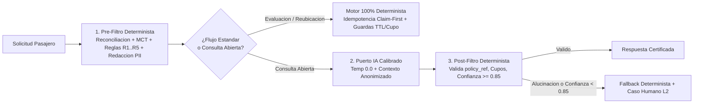

# Disruption Companion — Backend Vertical Slice (Caso A)

Microservicio backend en **Java 25**, **Spring Boot 4.1.2** y **PostgreSQL 17** bajo **Arquitectura Hexagonal estricta**, diseñado para gestionar disrupciones operativas de vuelos con precisión determinista en reglas tarifarias/cupos y asistencia de IA gobernada sin exposición de datos personales (PII).

---

## 1. Problema y Resultado de Ingeniería

Durante una disrupción operativa (atrasos, cambios de puerta o pérdidas de conexión), los pasajeros reciben información contradictoria entre sistemas legados y pantallas de aeropuerto, mientras el *contact center* se satura. Este *vertical slice* resuelve de extremo a extremo el escenario base **`ABC123`** (y escenarios de fallo/caos):

1. **Reconciliación de fuentes (`get_operational_events`):** Descarta automáticamente eventos de fuentes degradadas (`LEGACY_MIRROR` en `_meta.sources_degraded` que reportaba `ON_TIME`) y consolida las fuentes saludables (`OPS_CORE`: atraso de **160 min** en `S1 LA500` con nueva salida `17:10`; `AIRPORT_FEED`: cambio a **puerta 24**).
2. **Cálculo determinista de pérdida de conexión (`missed_connection`):** Determina que la llegada reprogramada a Lima (`20:35`) incumple el tiempo mínimo de conexión (`MCT = 60 min`) frente a la salida de `S2 LA2410` (`19:05`, margen `-90 min`), activando **`missed_connection = true`**.
3. **Evaluación de políticas (`POL-DELAY-2026-03`) y datos parciales:** Aplica **`R3`** (`missed_connection == true -> REBOOK_NO_FEE`), neutralizando la ausencia de `fare_conditions.change_penalty_amount` en la tarifa `LIGHT`. Detecta que `P2` es menor (`CHILD`, 7 años) y activa **`R5`** (`PRIORITY_HANDLING`, `requires_human_approval = true`). Si el pasajero solicita compensación en efectivo, activa **`R4`** (`CASH_COMPENSATION`, `requires_human_approval = true`).
4. **Filtrado determinista de catálogo (`get_eligible_options`):** Rechaza **`O2`** (`LA2450`, solo `1` asiento para `2` pasajeros y `fare_difference = 180000 CLP > 0`), rechaza **`O3`** (`REFUND` con `confidence = LOW` en tarifa no reembolsable) y selecciona **`O1`** (`LA2412`, `2026-09-16 08:15`, `4` asientos, `0 CLP`, `HIGH`), marcando requerimiento de pernocta (`overnightRequired = true`).

---

## 2. Clasificación de Componentes: Determinístico vs. IA Gobernada vs. Control Humano



| Etapa / Capacidad del Flujo | Clasificación | Justificación Operativa y de Seguridad |
|---|---|---|
| Reconciliación de eventos y descarte de `_meta.sources_degraded` | **Determinístico** | Prohibido delegar a un LLM qué fuente técnica es saludable; evita usar estados obsoletos (`LEGACY_MIRROR`). |
| Cálculo de pérdida de conexión (`MCT = 60 min`) y reglas `R1..R5` | **Determinístico** | Ejecución en memoria en milisegundos, costo cero de inferencia y consistencia estricta sobre derechos tarifarios. |
| Filtrado de opciones (`TTL`, `seats_available >= 2`, `fare_difference == 0`) | **Determinístico** | Impide ofrecer vuelos sin cupo para el grupo familiar (`O2`) o catálogos vencidos (`EXP123`). |
| Explicación ante preguntas abiertas (`POST .../consultas`) | **AI-Assisted (Gobernado)** | Temperatura `0.0`, sin PII, encerrado en un *Sándwich de Seguridad* que exige `confidenceScore >= 0.85` y `policy_ref` vigente. |
| Orquestación libre de escrituras (*Agentic tool-calling*) | **Descartado deliberadamente** | Ningún modelo ejecuta escrituras directas sobre `create_rebooking_request`; toda mutación pasa por el caso de uso determinista. |
| Efectivo (`R4`), menor en pernocta (`R5`) y conflicto de fuentes | **Human-Controlled** | Escala a la cola `DISRUPTION_L2` (`create_human_case`) reutilizando un único caso activo por reserva (`HC-4471`). |

---

## 3. Decisiones Clave de Arquitectura y Alternativas Descartadas

| Decisión | Por qué se tomó | Qué se pierde (Trade-off) | Condición de Reingreso (Qué la reabriría) |
|---|---|---|---|
| **1. Patrón "Sándwich Determinista" en vez de Agente LLM con *Tool-Calling* libre** | Garantiza que ningún pasajero reciba promesas de vuelos sin cupo (`O2`), reembolsos inválidos (`O3`) ni notificaciones sin `policy_ref`. Si la IA falla o alucina, el post-filtro activa *fallback* determinista sin afectar disponibilidad. | Menor flexibilidad conversacional libre fuera de los hechos verificados del viaje. | Si se incorpora un asistente post-reubicación para servicios ancillaries no críticos con catálogo estático. |
| **2. Idempotencia *Claim-First* (`IN_PROGRESS`) + Estado `INDETERMINATE_PENDING_RECONCILIATION` ante `503`** | Se inserta primero el reclamo `IN_PROGRESS` en PostgreSQL (`UNIQUE(booking_id, idempotency_key)`) antes de llamar al *upstream*, bloqueando hilos concurrentes. Si el *upstream* devuelve `503 UPSTREAM_TIMEOUT`, la fila pasa a `INDETERMINATE_PENDING_RECONCILIATION`, impidiendo emitir doble boleto en otra opción hasta reconciliar. | El pasajero no puede elegir una segunda opción distinta en autoservicio mientras se reconcilia la transacción pendiente. | Si el sistema *upstream* habilita consulta síncrona de estado por `idempotency_key` en $< 500\text{ ms}$. |
| **3. Arquitectura Hexagonal Pura + Transacciones Cortas (`open-in-view: false`)** | `domain` y `application` no dependen de Spring/JPA (verificado con **ArchUnit**), y no se abre `@Transactional` durante llamadas de red externas, protegiendo el pool JDBC. | Mayor estructura inicial de mapeo entre entidades JPA y modelos inmutables. | Ninguna para servicios críticos de operaciones aéreas. |

---

## 4. Especificación Complementaria Frontend / Experiencia del Pasajero

El contrato JSON de los 4 endpoints alimenta la interfaz móvil/web del pasajero sin duplicar reglas de negocio en el cliente:
1. **Pantalla 1 — Diagnóstico y Cambio en 1 Clic (`GET .../evaluaciones`):** Muestra el atraso verificado (`160 min`, puerta `24`), la pérdida de conexión en Lima, la opción recomendada **`O1` (`LA2412`, costo \$0 CLP por `POL-DELAY-2026-03 · R3`)**, la insignia de asistencia prioritaria familiar (`R5`, pernocta con menor) y la razón transparente por la cual `O2` (`LA2450`) fue descartada (*"Solo 1 asiento disponible para 2 pasajeros"*).
2. **Pantalla 2 — Confirmación Idempotente (`POST .../reubicaciones`):** Envía `Idempotency-Key` generado al cargar la vista. Reintentos con la misma llave devuelven `replayedIdempotent: true` (`200 OK`); ante `503 UPSTREAM_TIMEOUT` informa que la reserva está en reconciliación sin inducir un segundo cambio.
3. **Pantalla 3 — Consultas Verificadas (`POST .../consultas`):** Muestra la respuesta respaldada por `validatedPolicyRef: "POL-DELAY-2026-03"` y vincula cualquier requerimiento adicional (como `R4`) al caso humano único de la reserva (`humanCaseId: "HC-4471"`).

---

## 5. Ejecución Rápida, Pruebas y Riesgos hacia Producción

```bash
# 1. Ejecutar las 98 pruebas automatizadas (Unitarias + ArchUnit + OWASP + Testcontainers PostgreSQL 17)
mvn -B clean test

# 2. Levantar PostgreSQL 17 + API en Docker Compose (puerto 8080)
docker compose up --build -d

# 3. Probar los 4 endpoints del vertical slice
curl -s http://localhost:8080/operaciones/vuelos/v1/disrupciones/reservas/ABC123/evaluaciones | jq
curl -s -X POST http://localhost:8080/operaciones/vuelos/v1/disrupciones/reservas/ABC123/consultas \
  -H "Content-Type: application/json" -d '{"question":"¿Que opciones tengo para llegar a Mexico con mi hijo?"}' | jq
curl -s -X POST http://localhost:8080/operaciones/vuelos/v1/disrupciones/reservas/ABC123/reubicaciones \
  -H "Content-Type: application/json" -H "Idempotency-Key: idem-latam-2026-0001" -d '{"optionId":"O1"}' | jq
curl -s -X POST http://localhost:8080/operaciones/vuelos/v1/disrupciones/reservas/ABC123/escalamientos \
  -H "Content-Type: application/json" -H "Idempotency-Key: idem-human-2026-0001" \
  -d '{"reason":"Grupo familiar con menor requiere asistencia de pernocta en Lima"}' | jq
```

*(El contrato OpenAPI 3.0.3 completo con los **68 casos E2E reales** se encuentra en [`openapi.yaml`](./openapi.yaml). El reloj de evaluación `disruption.clock.fixed-instant` y los triggers de prueba `disruption.ai.simulation-triggers-enabled` son configurables en `application.yml`).*

### Riesgos Identificados y Próximos Pasos hacia Producción
- **Reconciliador Asíncrono (Outbox + Pub/Sub):** *Worker* para resolver registros en `INDETERMINATE_PENDING_RECONCILIATION` o `IN_PROGRESS` huérfanos.
- **Homogeneización de Errores de Conector HTTP:** Personalizar `ErrorReportValve` de Tomcat para que rechazos tempranos de socket (`%2F`, `%00`) devuelvan el mismo JSON `ApiErrorResponse` que `StrictHttpFirewallFilter`.
